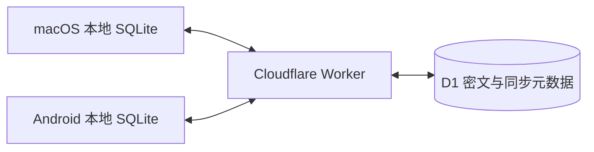

# Pindo

轻量待办应用，提供 macOS 菜单栏客户端、Android 客户端和 Cloudflare 端到端加密同步服务。

- 待办支持日期、分组、备注、三种状态、三级子项、父子完成联动及批量管理。
- macOS 支持置顶清单、全局快捷键、快速记录、原生 Markdown 编辑器、字体设置和中英文界面。
- Android 提供清单、日历、管理和设置，支持离线编辑、Markdown 预览及保护备份。
- 两端使用 SQLite 保存资料；同步支持设备配对、暂停、离线队列、并发备注与设备撤销。

## 下载与运行

[macOS 下载](https://github.com/CodexSpaceSafe-Projects/pindo/releases/latest) · [Android 下载](https://github.com/CodexSpaceSafe-Projects/pindo/releases?q=android-build-&expanded=true)

macOS 最低 14，支持 Apple Silicon 和 Intel。解压后将 `Pindo.app` 移到 `/Applications`；应用出现在菜单栏，可在设置中开启登录启动。当前使用临时签名，尚未配置 Developer ID 与公证。Android 最低 8.0（API 26），下载附件 `Pindo-Android-debug.apk`；当前安装包使用调试签名。

Android 的 CI 测试包版本包含构建号与提交短 SHA，可在设置底部核对；本地构建标为 `local`。不同测试包的调试签名可能不同；覆盖安装受阻时请保留原应用和资料，不要通过卸载或清除数据排查同步问题。

## 本地构建

macOS 安装 Xcode 15+ 或 Command Line Tools：

```sh
swift test --jobs 4
bash scripts/build-app.sh
open dist/Pindo.app
```

Android 安装 JDK 17 和 Android SDK 35：

```sh
cd android
./gradlew testDebugUnitTest lintDebug assembleDebug
```

APK 输出到 `android/app/build/outputs/apk/debug/app-debug.apk`。服务端构建和跨端验证见 [开发说明](DEVELOPMENT.md)。推送到 `main` 后，GitHub Actions 运行测试与构建，成功后发布应用下载。

## 保存与同步

macOS 资料位于 `~/Library/Application Support/Pindo/pindo.sqlite`；文字停止输入约 600ms 后保存，关闭编辑器时补存。快照保存在同一数据库，每 30 秒检查变化，保留最多 100 份、30 MB，可在设置中恢复或导出。Android 在应用私有目录保存资料，导入前建立保护备份。

导出为明文 JSON，只包含待办、分组和备注，需自行妥善保存。导入保留本机设置；导入或恢复会替换当前内容，并作为本地修改参与已连接资料库的同步。

在同步设置中填写服务地址和初始化密钥创建资料库，再通过已连接设备生成一次性配对信息加入其他设备。配对信息包含恢复密钥，只应在自己的设备之间传递。设备列表显示各客户端的设备名称并标注本机；名称默认取系统名称，可在各自客户端的同步设置中修改。暂停同步仍允许离线编辑；恢复连接后继续上传。检查点用于同步恢复，本机快照用于找回误改的内容。

## Cloudflare 服务端

服务端由 **TypeScript Worker + D1 数据库**组成，源码位于 [`backend/cloudflare/`](backend/cloudflare/)。客户端负责业务规则、加密解密和备注冲突合并；Worker 负责设备鉴权、密文上传下载、回执、加密检查点及安全回收。密文分块也存放在 D1，当前不使用 R2 或 Durable Objects。



当前面向个人部署、一个资料库多设备同步，尚无多用户注册；首台设备使用 `BOOTSTRAP_SECRET` 创建唯一资料库，其他设备通过一次性邀请加入。服务端管理用的 `RECOVERY_SECRET` 与客户端的数据加密密钥不同。

自部署需要创建空 D1、执行初始化 SQL、创建 Worker 并设置两个服务端 Secret，再打包并通过 Cloudflare Workers API 发布。完整步骤、命令及已有服务更新方法见 [Cloudflare 部署说明](DEVELOPMENT.md#cloudflare-部署)。

仓库附带的 staging 地址为 <https://example.com>，资源以 [`staging.json`](backend/cloudflare/deployments/staging.json) 为准。**推送到 GitHub 会自动发布客户端，但不会自动部署 Worker。** 服务端 CI 只测试、生成构建包并检查已有 staging；`npm run build:staging` 也只生成部署包。线上版本应以 Cloudflare 的部署记录为准。

源码与验证入口：`Sources/`、`Tests/`、`android/`、`backend/cloudflare/`、`sync-vectors/`。协作规则见 [AGENTS.md](AGENTS.md)。
