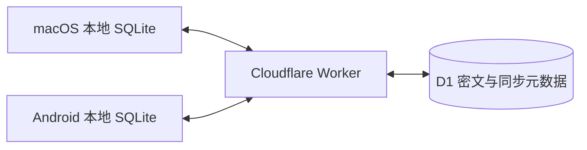

# Pindo

轻量待办应用，提供 macOS 菜单栏客户端、Android 客户端和 Cloudflare 端到端加密同步服务。

- 待办支持日期、分组、备注、三种状态、三级子项、父子完成联动及批量管理。
- macOS 支持置顶清单、全局快捷键、快速记录、原生 Markdown 编辑器、字体设置和中英文界面。
- Android 采用暖白纸感与克制蓝色，以今天、日历、清单组织事项；支持连续快速记录、无边框阅读写作、上下文批量操作、离线编辑、深浅主题及宽屏侧栏。
- 两端使用 SQLite 保存资料；同步支持设备配对、暂停、离线队列、并发备注与设备删除。

Android 事项圆圈依次切换“待办 → 进行中 → 已完成 → 待办”。父项自动汇总子项进度；普通未完成视图中，已完成子项保留在尚未完成的父项下。整棵事项完成后，可在“清单”或已完成筛选中查看和恢复。

## 下载与运行

[macOS 下载](https://github.com/CodexSpaceSafe-Projects/pindo/releases/latest) · [Android 下载](https://github.com/CodexSpaceSafe-Projects/pindo/releases?q=android-build-&expanded=true)

macOS 最低 14，支持 Apple Silicon 和 Intel。解压后将 `Pindo.app` 移到 `/Applications`；应用出现在菜单栏，可在设置中开启登录启动。当前使用临时签名，尚未配置 Developer ID 与公证。Android 最低 8.0（API 26），正式下载附件为 `Pindo-Android.apk`，使用长期固定签名。

Android 正式包保持 `com.pindo.app`、固定签名和递增版本号，后续 APK 可直接覆盖安装，保留事项、本机偏好和同步凭据。版本包含构建号与提交短 SHA，可在设置底部核对。开发包显示为 `Pindo Dev`，使用独立包名，不覆盖正式安装。

**已安装旧调试包的用户先不要卸载。** 旧 `Pindo-Android-debug.apk` 在不同 CI 构建中用了不同签名，原临时私钥未保存；新包无法绕过 Android 的签名校验。切换固定签名版本前，先导出资料并在其他已连接设备核对数据；JSON 导出不含本机偏好和同步凭据，需要保留设置记录并重新配对。不要把卸载或清除数据当作正常升级步骤。

## 本地构建

macOS 安装 Xcode 15+ 或 Command Line Tools：

```sh
swift test --jobs 4
bash scripts/build-app.sh
open dist/Pindo.app
```

Android 安装 JDK 17 和 Android SDK 35：

```sh
cd android
./gradlew testDebugUnitTest lintDebug assembleDebug
```

开发 APK 输出到 `android/app/build/outputs/apk/debug/app-debug.apk`。正式签名配置与覆盖升级验证见 [开发说明](DEVELOPMENT.md#android-发布与覆盖升级)。推送到 `main` 后，GitHub Actions 验证测试、lint、签名和覆盖升级，再发布正式 APK；缺少固定签名 Secret 时暂停 Android 发布，不以临时调试包替代。

## 保存与同步

macOS 资料位于 `~/Library/Application Support/Pindo/pindo.sqlite`；文字停止输入约 600ms 后保存，关闭编辑器时补存。快照保存在同一数据库，每 30 秒检查变化，保留最多 100 份、30 MB，可在设置中恢复或导出。Android 在应用私有目录保存资料，导入前建立保护备份。

导出为明文 JSON，只包含待办、分组和备注，需自行妥善保存。导入保留本机设置；导入或恢复会替换当前内容，并作为本地修改参与已连接资料库的同步。

在同步设置中填写服务地址和初始化密钥创建资料库，再通过已连接设备生成一次性配对信息加入其他设备。配对信息包含恢复密钥，只应在自己的设备之间传递。设备列表显示各客户端的设备名称并标注本机；名称默认取系统名称，可在各自客户端的同步设置中修改。暂停同步仍允许离线编辑；恢复连接后继续上传。检查点用于同步恢复，本机快照用于找回误改的内容。

在“管理设备”中选择“删除这个设备”，确认后会从服务器的在线数据库删除该设备的登记、访问凭据、配对记录和同步租约，并立即从列表移除。共享事项与该设备已下载的本机资料保留；再次加入需要重新配对。当前正在使用的设备不能删除，请在另一台已连接设备上操作。仅暂停同步时使用“停用云同步”。

## Cloudflare 服务端

服务端由 **TypeScript Worker + D1 数据库**组成，源码位于 [`backend/cloudflare/`](backend/cloudflare/)。客户端负责业务规则、加密解密和备注冲突合并；Worker 负责设备鉴权、密文上传下载、回执、加密检查点及安全回收。密文分块也存放在 D1，当前不使用 R2 或 Durable Objects。



当前面向个人部署、一个资料库多设备同步，尚无多用户注册；首台设备使用 `BOOTSTRAP_SECRET` 创建唯一资料库，其他设备通过一次性邀请加入。服务端管理用的 `RECOVERY_SECRET` 与客户端的数据加密密钥不同。

自部署需要创建空 D1、执行初始化 SQL、创建 Worker 并设置两个服务端 Secret，再打包并通过 Cloudflare Workers API 发布。完整步骤、命令及已有服务更新方法见 [Cloudflare 部署说明](DEVELOPMENT.md#cloudflare-部署)。

公开仓库只提供[虚构的配置示例](backend/cloudflare/deployments/staging.example.json)；个人服务地址、账号和数据库标识保存在 Git 忽略的本地配置中，应用也不内置个人服务地址。**推送到 GitHub 会自动发布客户端，但不会自动部署 Worker。** 服务端 CI 仅运行本地验证并生成通用构建包；个人部署包由本机生成，不上传为 CI 附件。线上版本以自己的 Cloudflare 部署记录为准。

源码与验证入口：`Sources/`、`Tests/`、`android/`、`backend/cloudflare/`、`sync-vectors/`。协作规则见 [AGENTS.md](AGENTS.md)。
